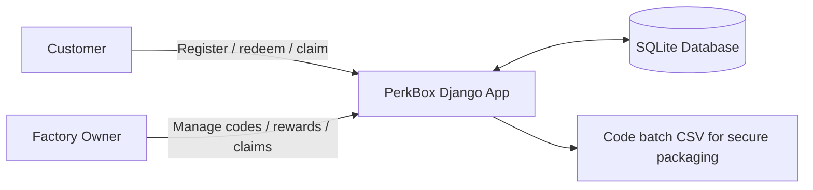
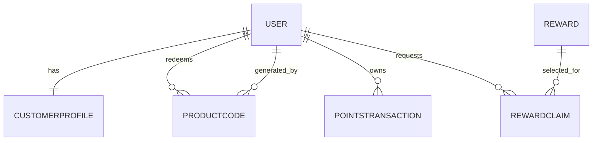

# Architecture

## Stack
- **Django**: authentication, server-side validation, ORM, admin and CSRF protection in one framework.
- **SQLite**: zero-configuration local database for the assignment; PostgreSQL is recommended for production concurrency and scale.
- **Django templates + CSS + vanilla JS**: polished responsive interface without a separate frontend build pipeline.

## Main entities
- `User`: customer or staff identity.
- `CustomerProfile`: customer points balance.
- `ProductCode`: unique one-time code, redemption state, customer and timestamp.
- `PointsTransaction`: points earned, spent or refunded with a reason and reference.
- `Reward`: catalogue item, point cost, stock and active state.
- `RewardClaim`: requested reward, points reserved, status and staff decision.

## Redemption flow
1. Customer submits code.
2. Server normalizes input and opens an atomic database transaction.
3. Code row is locked where supported; conditional update requires `is_redeemed=False`.
4. Database unique constraints and conditional update ensure a code cannot be credited twice.
5. Customer wallet and ledger are updated in the same transaction.

## Claim flow
1. Request validates active reward, stock and available balance.
2. Points are reserved immediately; claim starts as `PENDING`.
3. Staff approval reduces stock and marks `APPROVED`.
4. Staff rejection marks `REJECTED` and refunds reserved points in one transaction.
5. A claim already processed cannot be processed again.

## Context diagram

## Data relationship diagram

## Security boundaries and limitations
Django password hashing, session authentication, CSRF protection, server-side form validation, staff-only owner views, random codes and database constraints are used. SQLite's `select_for_update` behavior is limited; production should use PostgreSQL and add request throttling, monitoring, audit logs, HTTPS, verified email, backups and operational controls for printed code batches.
